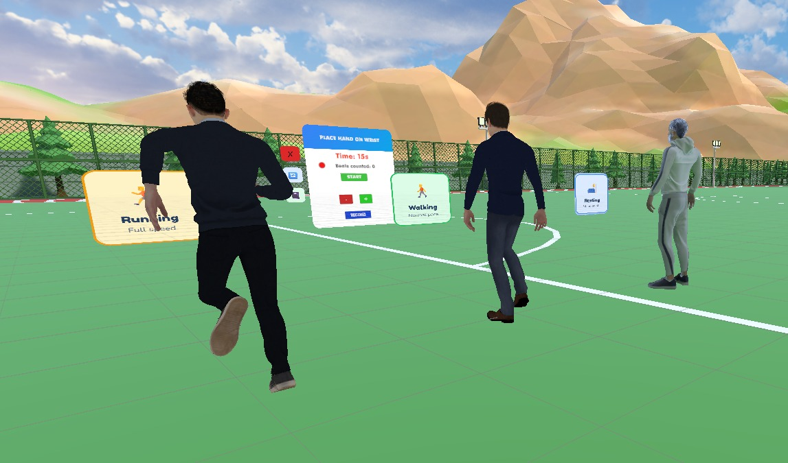
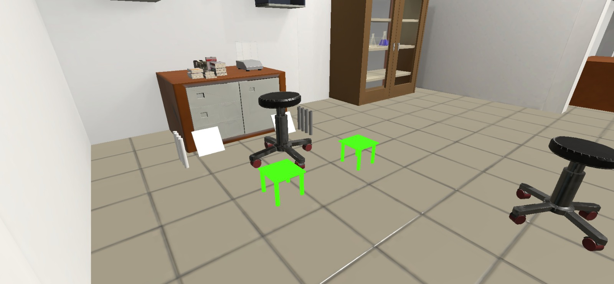
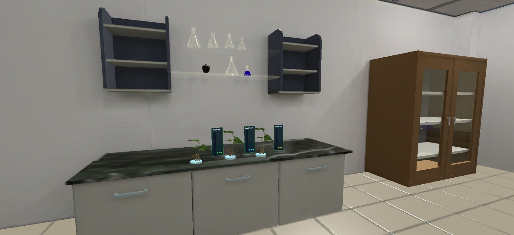
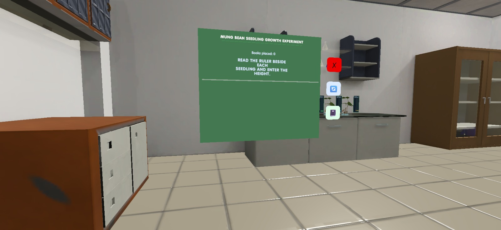
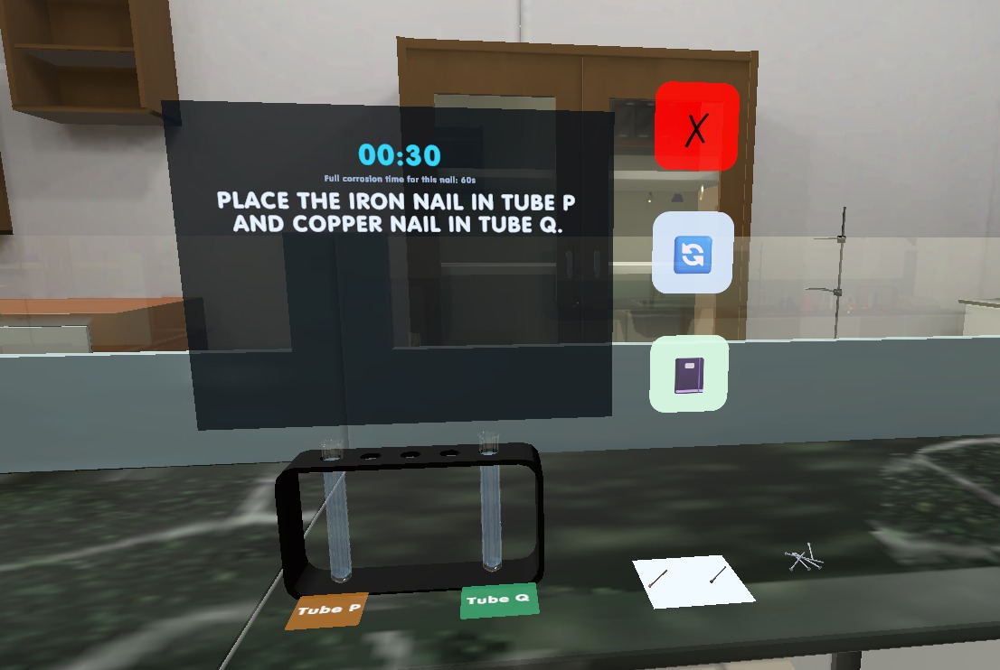
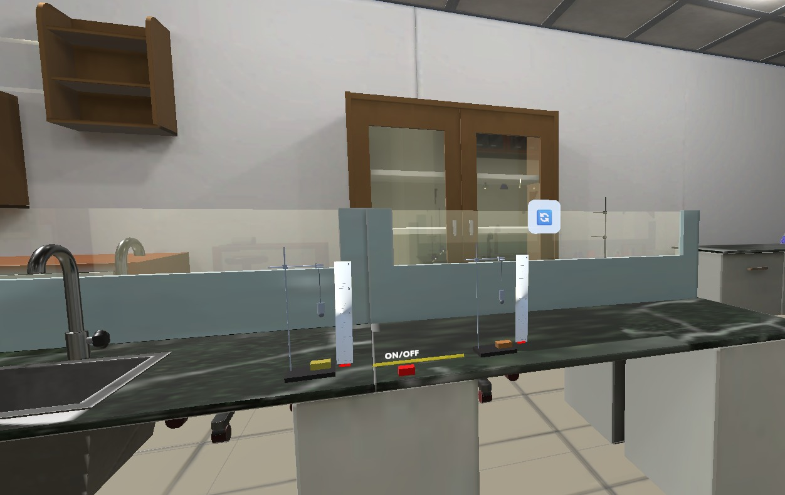

# SciLab VR

**SciLab VR** is an immersive Unity VR science laboratory for Form 4 students on **Meta Quest 3**. Learners carry out guided, curriculum-based experiments: they observe, measure, record and submit results in a virtual lab, with feedback and progression at every step.

**Role:** VR Game Designer / Developer · **Engine:** Unity 6 · **Language:** C# · **Platform:** Meta Quest 3 (standalone) · **Languages:** English & Bahasa Melayu

▶ **[Watch the gameplay video on YouTube](https://youtu.be/V43zmtV2cBs)** · 🌐 [Portfolio case study](https://mthportfolio.chronocraftstudios.com/scilab-vr.html)

---

## Project Context

Developed in 2026 at **Spark Capital** as part of a Malaysian government education-technology project. The application was **delivered to the client and accepted**.

The experience contains **five playable levels covering 13 Form 4 science experiments** from five curriculum chapters: a field activity on how pulse changes with gender, age and activity, followed by four laboratory levels.

## My Role

- Designed and developed the **gameplay, experiment interactions and recording mechanics for the four laboratory levels**: hollow vs. solid structures under load, seedling growth over six days, materials and latex coagulation, and changes in apple slices over time.
- Built the activities where players **collect measurements with the controllers, enter and submit results**, and view calculated summaries such as the seedling mean.
- Designed the **bilingual (English / Bahasa Melayu) text system**, replacing duplicated per-language UI panels with a single reusable approach.
- Profiled and optimised the experience for **standalone Quest 3 performance**.

## Gameplay

<table>
  <tr>
    <td width="50%" align="center"><br><sub><b>Pulse field activity</b>: how pulse rate changes when walking, running and resting.</sub></td>
    <td width="50%" align="center"><br><sub><b>Structures under load</b>: comparing hollow and solid structures.</sub></td>
  </tr>
  <tr>
    <td width="50%" align="center"><br><sub><b>Seedling growth</b>: measuring mung bean seedlings beside rulers.</sub></td>
    <td width="50%" align="center"><br><sub><b>Guided instructions</b>: experiment panel with retry and notebook controls.</sub></td>
  </tr>
  <tr>
    <td width="50%" align="center"><br><sub><b>Corrosion experiment</b>: timed iron vs. copper nail test.</sub></td>
    <td width="50%" align="center"><br><sub><b>Material impact test</b>: physics-based drop test with measurement.</sub></td>
  </tr>
</table>

More in-headset result panels are in [`Media/Panels`](Media/Panels).

## Key Systems

### Experiment & Chapter Management
Dedicated managers and controllers coordinate experiment states, progression, completion, retry flows, UI panels and chapter-specific activities.

### Interactive Experiment Mechanics
- Physics-based hardness / impact experiments
- Chemical dripping and laboratory interactions
- Measurement and ruler-based activities
- Test-tube, beaker, nail, rubber-strip and placement interactions
- Experiment confirmation and validation workflows
- Timed pulse-measurement sessions with haptic and visual feedback

### Virtual Science Notebook
A reusable notebook records experiment results and organises them by chapter and activity: recorded entries, pass/fail feedback, chapter completion states, multi-page content, star/progression feedback and runtime positioning in VR.

### Bilingual Interface
English and Bahasa Melayu across experiment instructions, status messages, navigation, confirmation panels and notebook content.

### VR Feedback & Interaction
World-space UI placement, haptic, visual and audio feedback, object placement and sockets, physics interactions, and NPC activity/animation behaviour.

## Repository Structure

```text
SciLabVR/
├── Scripts/
│   ├── Core/             # Shared systems: notebook, confirmation, placement, settings, lab objects
│   ├── Chapter1_Pulse/   # Pulse field activity: sessions, haptics, wrist detection, recording
│   ├── Chapter2/         # Structures under load, seedling growth, rulers and graphs
│   ├── Chapter3/         # Materials, corrosion, latex and impact experiments
│   ├── UI/               # Chapter overlay UI
│   └── Editor/           # Editor tools for UI setup and button audio/animation
├── Media/
│   ├── Gameplay/         # In-game screenshots
│   └── Panels/           # Experiment result panels (Chapters 1–3)
├── CODE_SHOWCASE.md      # Guided tour of the most important scripts
└── README.md
```

New to the code? Start with **[CODE_SHOWCASE.md](CODE_SHOWCASE.md)**.

## Technical Highlights

Unity 6 · C# · XR Interaction Toolkit · Meta Quest 3 · physics-based experiment mechanics · runtime validation · state and progression management · world-space UI · TextMeshPro · haptic feedback · PlayerPrefs settings · modular chapter controllers · data recording and result presentation

## Repository Note

This public repository contains selected scripts to demonstrate the technical implementation and architecture. The full Unity project, scenes and third-party assets are client-owned and not included. Unity `.meta` files are kept alongside each script.
